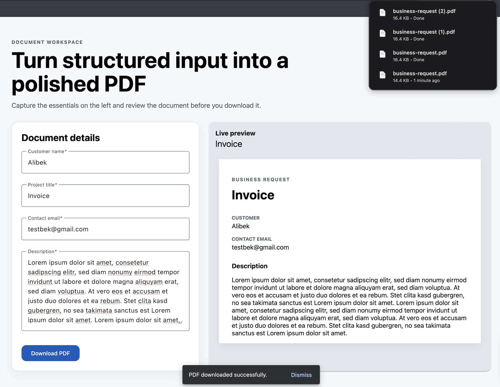

# Dynamic Form-to-PDF Web Client

A professional Angular web client that captures structured business input and
generates a downloadable PDF directly in the browser.

The application uses Angular Standalone Components, strict TypeScript,
Reactive Forms, Angular Material, and client-side PDF generation with
`pdfmake`. A live HTML preview helps users review the document before
downloading it.

## Local setup

```bash
npm install
ng serve
```

Open `http://localhost:4200/` in a browser.

## Architecture Overview

The form component owns the typed reactive form and is the source of editable
state. A valid submission is passed in one direction to a dedicated PDF
generation service, which maps the model to a typed `pdfmake` document
definition and triggers the browser download.

The interface uses a split-screen layout with the Material form on the left
and an HTML document preview on the right. Form `valueChanges` are normalized
into the preview model and debounced by 300 ms before the standalone preview
component receives the latest state.

## Development

Run the unit tests with:

```bash
ng test
```

Build the application for production with:

```bash
ng build
```

## Engineering Standards

- Target Lighthouse scores above 90 for Performance, Accessibility, Best
  Practices, and SEO.
- Mobile-first responsive design stacks the form and preview vertically on
  small screens.
- Standalone Angular components, strict TypeScript, debounced preview updates,
  and focused unit tests keep the core business logic maintainable.
- AI-assisted development and pull-request review tools such as GitHub Copilot
  and CodeRabbit may be used, with human review remaining responsible for the
  final changes.

Run the Lighthouse quality gate locally after building:

```bash
npm run build
npm run lighthouse
```

## Showcase



[View the generated PDF example](docs/showcase-invoice.pdf)

## GitHub Pages

Pushes to `main` run the GitHub Actions workflow in
`.github/workflows/deploy-pages.yml`. The workflow installs dependencies, runs
the unit tests, builds the application with the repository base path, and
publishes the static output to GitHub Pages.

## License

This project is released under the MIT License.
